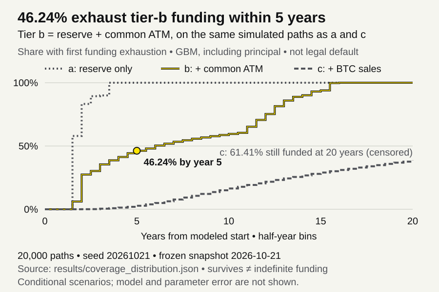

# Strategy coverage Monte Carlo: conditional funding exhaustion across three source tiers

[](https://github.com/RahilBhavan/strategy-coverage-montecarlo/actions/workflows/ci.yml)



This Python model extends the existing static preferred-coverage workbook into weekly BTC, mNAV, trading-volume and EUR/USD paths. It first reproduces the static result, then tracks the first time each funding waterfall cannot meet modeled charges. Its probabilities are conditional on chosen processes and financing rules; they are not Strategy default forecasts.

## Results

- Static reproduction: $1,559.6675 million annual charges, 37.5465 reserve-only months and 15.1876 reserve-plus-common years. The workbook reports $1,559.6730 million, 37.5463 months and 15.1875 years; the note-interest rounding difference is documented (`results/static_check.json`).
- Under the base GBM assumptions, 20,000 paths produce 46.240% five-year funding failure for reserve + common ATM (Monte Carlo standard error 0.353 percentage points), including modeled note principal. The block-bootstrap case gives 47.850% (`results/main.json`, seed 20261021, as of October 21, 2026).
- One-at-a-time assumptions shift five-year tier-b exhaustion from 19.27% (no BTC link in mNAV) to 79.08% (peak-drawdown link), versus 46.21% base in the 10,000-path sensitivity run (`results/tornado.json`). These scenario differences are not confidence bounds.
- Results also include source tiers, principal-on/off comparisons, first-passage distributions, 20-year censoring, parameter sensitivities and simulation convergence.
- 55 tests cover source hashes, filing parsing, static agreement, source exhaustion, correlation, invalid inputs and reproducibility.

## How it works

`mc/inputs.py` reconstructs dated inputs from read-only source copies and explicit static-model estimates. `history.py` estimates calibration from frozen histories. `paths.py` uses BTC lognormal or block-bootstrap shocks and correlated log-mNAV/ADV mean reversion. `engine.py` maintains separate reserve, ATM capacity, share counts and BTC balances for reserve-only (a), reserve/common (b), and reserve/common/BTC-sale (c) paths. `run.py` writes JSON analyses.

## Run it

Tested with Python 3.14.7, NumPy 2.5.4 and pytest 9.1.1. No workbook application or credentials are needed for the frozen run.

```bash
git clone https://github.com/RahilBhavan/strategy-coverage-montecarlo.git
cd strategy-coverage-montecarlo
python3 -m venv "$HOME/scratch/strategy-coverage-montecarlo/venv"
"$HOME/scratch/strategy-coverage-montecarlo/venv/bin/python" -m pip install -r requirements.txt
python3 scripts/restore_data.py
"$HOME/scratch/strategy-coverage-montecarlo/venv/bin/python" -m pytest -q
"$HOME/scratch/strategy-coverage-montecarlo/venv/bin/python" -m mc.run
```

For an exact full-run byte comparison, run `"$HOME/scratch/strategy-coverage-montecarlo/venv/bin/python" scripts/verify_reproduction.py`. Regenerate the figure with `python3 scripts/render_figure.py`.

The full run writes `results/*.json` and took about three minutes on this host. `--quick` uses 2,000 main paths and smaller sensitivity/convergence runs; it also overwrites `results/`. Source refresh (`python -m mc.fetch`) is separate, may depend on sibling caches and changes the snapshot. Restore the committed snapshot for the reported results.

## Repository layout

- `mc/` — input parsers, path processes, validation and funding engine.
- `data/` — compressed raw snapshot, derived calibration and static reference copies.
- `results/` — analysis JSON with settings and estimates.
- `tests/` — real-source, deterministic and stochastic behavior checks.
- `scripts/` — SHA-256-checked snapshot restoration.
- `docs/` — scope, methodology, provenance and verification.

## Documentation

- [Scope and acceptance](docs/spec.md) — agreed local v1.
- [Methodology](docs/methodology.md) — equations, funding policies and probability interpretation.
- [Sources](docs/sources.md) — observed inputs, estimated bridges and frozen provenance.
- [Correctness review](docs/review.md) — proven failures, repairs and remaining evidence limits.
- [Verification](docs/verification.md) — commands and comparison tolerances.

## Sources

[Q2 2026 10-Q](https://www.sec.gov/Archives/edgar/data/1050446/000105044626000044/mstr-20260630.htm), [October 19 8-K](https://www.sec.gov/Archives/edgar/data/1050446/000119312526424688/mstr-20261019.htm), earlier October filings and the [special-meeting proxy](https://www.sec.gov/Archives/edgar/data/1050446/000119312526413159/d503578ddef14a.htm) supply dated corporate evidence. Coinbase supplies BTC candles, ECB supplies FX, Yahoo supplies secondary MSTR price/volume data, and the local dat-accretion snapshot supplies 20 weekly mNAV observations. The static reference is copied read-only from commit `096efc4` of strategy-preferred-coverage-model. See [source coverage](docs/sources.md) for ranges and assumptions. Every raw file has a URL/hash sidecar; `data/frozen/index.json` identifies the exact restored bytes.

## Scope and limits

- Independent research, unaffiliated with Strategy. No trades, financing actions or solvency prediction.
- Funding failure means these modeled sources do not pay charges when due. It does not mean legal default; unpaid funding is accumulated and paths continue.
- The 1x issuance gate, ADV participation, financing fee, reserve target and principal pre-funding are policy assumptions. Remaining ATM registration is a cap, not assured demand.
- Annual BTC volatility uses history; the projected log drift is assumed zero. The 20-week mNAV sample is weak evidence. mNAV shock correlation is assumed zero in the base case; the BTC-level link still correlates paths. Sensitivities vary both.
- Weekly accrual is not a dividend/coupon payment calendar. The October 28 daily-dividend vote remains pending on October 21; no amendment is treated as enacted.
- Starting inputs mix observation dates and estimates. No operating cash flow, new preferred issuance, new debt/ATM program, taxes, balance-sheet strategy response or BTC repurchases are modeled. Default runs exclude non-reserve USD cash from funding.
- Note puts use a prior-week moneyness rule; maturity conversion and dilution are scenarios, not observed holder/company decisions. No make-whole adjustments or contractual path-dependent conversion eligibility rules are modeled.
- Calibration uses the October 21 snapshot, including observations after the October 16 static-comparison start. This is retrospective scenario analysis, not an out-of-sample backtest.
- Binomial standard errors describe simulation noise only. They omit parameter, model and data error; zero observed failures does not prove zero risk. Twenty-year survivors are censored, not infinitely funded.

## License

No license file yet. Third-party source material retains its own rights.

Part of [Rahil Bhavan's projects](https://github.com/RahilBhavan).
