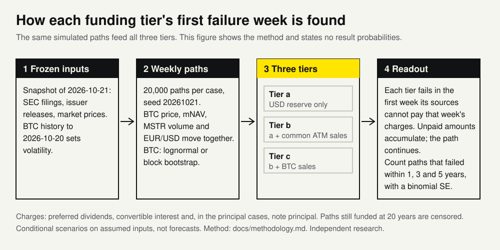

# Strategy coverage Monte Carlo: conditional funding exhaustion across three source tiers

A simulator that tests, over thousands of possible bitcoin price paths, how long Strategy's cash reserve, stock sales and bitcoin sales could keep paying its dividends and debt.

[](https://github.com/RahilBhavan/strategy-coverage-montecarlo/actions/workflows/ci.yml) [](LICENSE)



This Python model asks how long Strategy's funding sources can pay its preferred dividends, debt interest and note principal. It extends the [static preferred-coverage workbook](https://github.com/RahilBhavan/strategy-preferred-coverage-model), an Excel model of one fixed scenario, into weekly BTC, mNAV, trading-volume and EUR/USD paths. It records the first week each funding tier cannot meet modeled charges. This README describes the method and its checks; the estimates are in `results/*.json`.

The three funding tiers run on the same simulated paths:

- **Tier a**: the USD cash reserve only.
- **Tier b**: the reserve plus new common stock sold through the at-the-market (ATM) program.
- **Tier c**: tier b plus BTC sales.

## What it does

<!-- headline:start -->
- **Paths:** 20,000 weekly paths per case, seed 20261021, frozen snapshot 2026-10-21. Each path moves BTC price, mNAV, MSTR trading volume and EUR/USD together.
- **Two BTC processes:** lognormal (GBM) with assumed zero log drift and 66.2% annual volatility estimated from 2016-01-01 to 2026-10-20, and a circular block bootstrap of historical weekly returns in 8-week blocks, rescaled to the same drift and volatility. Both run with and without note principal.
- **What is counted:** the share of paths whose funding tier first cannot pay modeled charges within 1, 3 and 5 years, with its binomial standard error. Survival is tracked to 20 years; paths still funded then are censored.
- **Convergence:** the five-year tier-b estimate is rerun across 8 seeds at 500 to 50,000 paths to compare seed spread with the binomial standard error.
<!-- headline:end -->
- **Funding exhaustion, not default:** a tier is exhausted when its modeled sources cannot pay charges when due. Unpaid amounts accumulate and the path continues. This is not legal default.
- **Static check first:** the model first reproduces the workbook's fixed scenario. It gives $1,559.6675 million annual charges, 37.5465 reserve-only months and 15.1876 reserve-plus-common years; the workbook reports $1,559.6730 million, 37.5463 months and 15.1875 years. The gap is the workbook's rounded note interest (`results/static_check.json`).
- **Sensitivity:** a one-at-a-time tornado runs 20 assumption changes on 10,000 paths with common random numbers (`results/tornado.json`). A [paired sensitivity report](docs/assumption-sensitivity.md) ranks 13 assumptions with exact failure counts, Wilson intervals and paired standard errors.
- **What-if tool:** `python -m mc.run --set key=value` changes any model setting and prints base and changed probabilities on the same paths, with paired standard errors (see [Run it](#run-it)).
- **Reproducibility:** CI restores the SHA-256-checked snapshot, runs 83 tests and reruns the full analysis, which must reproduce every result file (JSON floats within 1e-12).

## How it works

`mc/inputs.py` reconstructs dated inputs from read-only source copies and explicit static-model estimates. `history.py` estimates calibration from frozen histories. `paths.py` uses BTC lognormal or block-bootstrap shocks and correlated log-mNAV/ADV mean reversion. `engine.py` maintains separate reserve, ATM capacity, share counts and BTC balances for each tier. `run.py` writes JSON analyses; `whatif.py` handles `--set`.

Terms:

- **mNAV** (net): MSTR's fully diluted market value divided by its net BTC value, which is BTC plus cash minus out-of-the-money convertible notes and preferred claims.
- **1x issuance gate**: no common stock is sold in a week when net mNAV is below 1.0 (`gate`). Strategy has filed no such policy; it is an assumption.
- **ADV participation**: the share of MSTR's average daily trading volume (ADV) that ATM sales may take, 2% by default (`participation`).

## Run it

Tested with Python 3.14.7, NumPy 2.5.4 and pytest 9.1.1. No workbook application or credentials are needed for the frozen run.

```bash
git clone https://github.com/RahilBhavan/strategy-coverage-montecarlo.git
cd strategy-coverage-montecarlo
python3 -m venv .venv
.venv/bin/python -m pip install -r requirements.txt
python3 scripts/restore_data.py
.venv/bin/python -m pytest -q
.venv/bin/python -m mc.run
```

For an exact full-run byte comparison, run `.venv/bin/python scripts/verify_reproduction.py`. Regenerate the first-passage figure (`results/funding_exhaustion.svg`) with `python3 scripts/render_figure.py` and the README method block with `python3 scripts/readme_headline.py`. Its `--check` mode, run in CI, also fails if any result probability appears in the README or `docs/`.

To change an assumption, pass `--set key=value` (repeatable). Keys are the fields of `mc.params.Params`; a wrong key prints the valid list. It prints base and changed probabilities on the same paths and writes nothing; `--quick` uses 2,000 paths. Raising ADV participation from 2% to 5% took about 4 seconds here:

```bash
.venv/bin/python -m mc.run --set participation=0.05
```

The output starts:

```text
Changed: participation 0.02 -> 0.05
20,000 GBM paths, seed 20261021, principal included, frozen snapshot 2026-10-21.
P(first funding exhaustion within N years), simulation SE in brackets:
tier years              base           changed     change (paired SE)
```

One row follows for each tier at 1, 3 and 5 years, then a tier key and the reminder that standard errors cover simulation noise only.

The full run writes `results/*.json` and took about three minutes on this host. `--quick` uses 2,000 main paths and smaller sensitivity/convergence runs; it also overwrites `results/`. Source refresh (`python -m mc.fetch`) is separate, may depend on sibling caches and changes the snapshot. Restore the committed snapshot for the reported results.

## Repository layout

- `mc/`: input parsers, path processes, validation and funding engine.
- `data/`: compressed raw snapshot, derived calibration and static reference copies.
- `results/`: analysis JSON with settings and estimates, plus the first-passage SVG.
- `tests/`: real-source, deterministic and stochastic behavior checks.
- `scripts/`: SHA-256-checked snapshot restoration, reproduction check, figure and README generators.
- `docs/`: scope, methodology, provenance and verification.

## Documentation

- [Public design system](DESIGN.md): Rahil Design 3.3.0, shared tokens and visual review rules.
- [Scope and acceptance](docs/spec.md): agreed local v1.
- [Assumption sensitivity](docs/assumption-sensitivity.md): ranked drivers, analytic checks and a five-minute example.
- [Methodology](docs/methodology.md): equations, funding policies and probability interpretation.
- [Sources](docs/sources.md): observed inputs, estimated bridges and frozen provenance.
- [Correctness review](docs/review.md): proven failures, repairs and remaining evidence limits.
- [Verification](docs/verification.md): commands and comparison tolerances.

## Sources

[Q2 2026 10-Q](https://www.sec.gov/Archives/edgar/data/1050446/000105044626000044/mstr-20260630.htm), [October 19 8-K](https://www.sec.gov/Archives/edgar/data/1050446/000119312526424688/mstr-20261019.htm), earlier October filings and the [special-meeting proxy](https://www.sec.gov/Archives/edgar/data/1050446/000119312526413159/d503578ddef14a.htm) supply dated corporate evidence. Coinbase supplies BTC candles, ECB supplies FX, Yahoo supplies secondary MSTR price/volume data, and the local dat-accretion snapshot supplies 20 weekly mNAV observations. The static reference is copied read-only from commit `096efc4` of strategy-preferred-coverage-model. See [source coverage](docs/sources.md) for ranges and assumptions. Every raw file has a URL/hash sidecar; `data/frozen/index.json` identifies the exact restored bytes.

## Scope and limits

- Independent research, unaffiliated with Strategy. No trades, financing actions or solvency prediction. Probabilities are conditional on the chosen processes and financing rules; they are not Strategy default forecasts.
- The 1x issuance gate, ADV participation, financing fee, reserve target and principal pre-funding are policy assumptions. Remaining ATM registration is a cap, not assured demand.
- Annual BTC volatility uses history; the projected log drift is assumed zero. The 20-week mNAV sample is weak evidence. mNAV shock correlation is assumed zero in the base case; the BTC-level link still correlates paths. Sensitivities vary both.
- Weekly accrual is not a dividend/coupon payment calendar. The October 28 daily-dividend vote remains pending on October 21; no amendment is treated as enacted.
- Starting inputs mix observation dates and estimates. No operating cash flow, new preferred issuance, new debt/ATM program, taxes, balance-sheet strategy response or BTC repurchases are modeled. Default runs exclude non-reserve USD cash from funding.
- Note puts use a prior-week moneyness rule; maturity conversion and dilution are scenarios, not observed holder/company decisions. No make-whole adjustments or contractual path-dependent conversion eligibility rules are modeled.
- Calibration uses the October 21 snapshot, including observations after the October 16 static-comparison start. This is retrospective scenario analysis, not an out-of-sample backtest.
- Binomial standard errors describe simulation noise only. They omit parameter, model and data error; zero observed failures does not prove zero risk. Sensitivity scenario differences are not confidence bounds. Twenty-year survivors are censored, not infinitely funded.

## License

[MIT](LICENSE). The license covers this project's code only. Third-party source material retains its own rights.

Part of [Rahil Bhavan's projects](https://github.com/RahilBhavan).
